# WheelStat


**[🇮🇹 Italiano](#italiano) · [🇬🇧 English](#english)**

<video src="https://github.com/user-attachments/assets/7b796619-36bd-4502-a876-5ac1e82d2781" controls width="100%">
  Il tuo browser non supporta il tag video.
</video>

---

<a id="italiano"></a>
## 🇮🇹 Italiano

**Telemetria per moto su ESP32.** Misura piega, impennata, forze G, velocità e tempi sul giro; li mostra su un piccolo OLED e su un sito che l'ESP32 serve da solo al telefono, senza internet e senza app.

[Cosa fa](#it-cosa) · [Cosa serve](#it-hardware) · [Avvio rapido](#it-avvio) · [Orientamento dell'IMU](#it-orientamento) · [Display](#it-oled) · [Sito](#it-web) · [Giri e tracciati](#it-giri) · [Misure](#it-misure) · [Dati](#it-file) · [Altre schede e componenti](#it-driver) · [Sviluppo](#it-sviluppo) · [Sicurezza](#it-sicurezza)

<a id="it-cosa"></a>
### Cosa fa

- **Piega, impennata/stoppie e forze G** da un'IMU (BNO055 o un'altra fra una decina), con un filtro che scarta gli urti delle buche e, per le IMU senza fusione propria, un filtro d'assetto che usa la velocità GPS per non perdere la piega in curva.
- **Velocità, posizione e cronometro sul giro** da un GPS fino a 10 Hz: traguardo e fino a due intertempi, con il **delta in tempo reale** sul tuo giro migliore.
- **Rischio grip** stimato da temperatura e umidità, che abbassa la soglia dell'allarme di piega.
- **Registrazione sulla flash interna**, tre campioni al secondo: circa cinque ore, senza scheda SD.
- **Sito sul telefono**: telemetria live, grafici e mappa di ogni sessione, confronto tra sessioni, tracciati salvati, download in CSV e GPX, impostazioni e aggiornamento del firmware via WiFi.
- **Componenti riconosciuti da soli**: sensore meteo, IMU, GPS e microSD si trovano all'accensione, senza configurare niente.
- **Interfaccia in italiano o in inglese**, scelta alla compilazione.

<p align="center">
  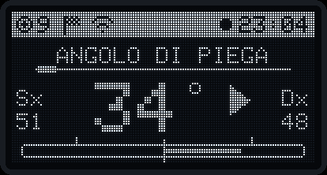
</p>

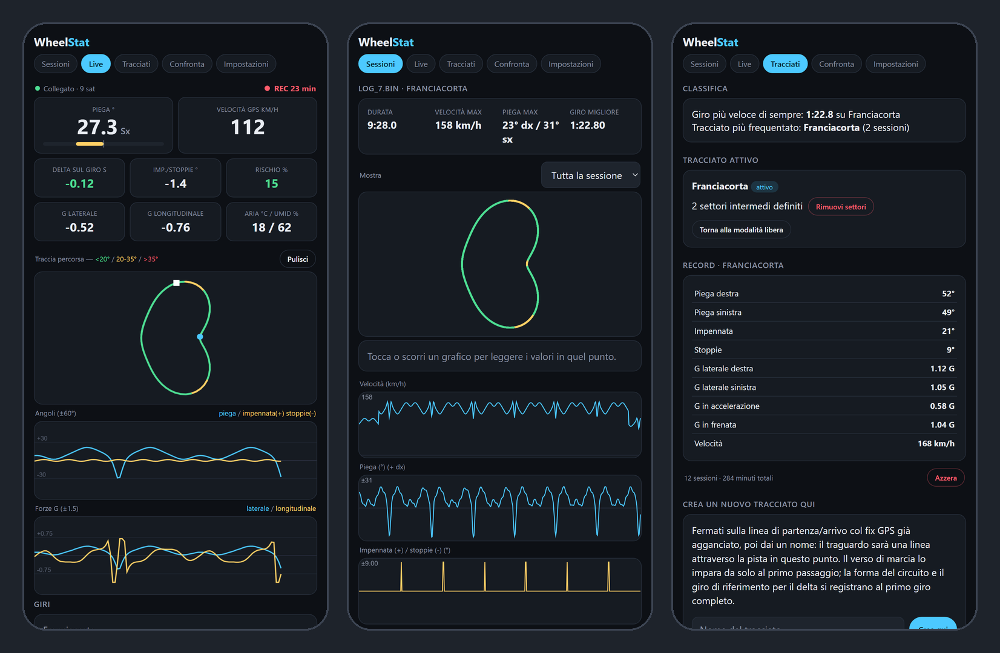

<a id="it-hardware"></a>
### Cosa serve

| Componente | Collegamento | Pin (ESP32 DevKit V1) | Note |
|---|---|---|---|
| ESP32 DevKit V1 | - | - | Anche S3, S2, C3: vedi [sotto](#it-driver) |
| IMU Bosch BNO055 | I2C | SDA 21 / SCL 22 | Indirizzo `0x28` (`0x29` su alcuni breakout) |
| OLED SSD1306 128×64 | I2C | SDA 21 / SCL 22 | Indirizzo `0x3C` |
| DHT22 | GPIO | 4 | Temperatura e umidità |
| GPS u-blox NEO-6M / 8M | UART2 | RX 16 / TX 17 | 9600 baud. **Il TX del modulo va su GPIO 16** |
| 4 pulsanti SU / GIÙ / OK / LOG | GPIO | 13 / 25 / 14 / 27 | Verso GND, nessuna resistenza |

Alimentazione da USB sul banco; sulla moto dai 12 V sotto chiave, con un convertitore a 5 V e, se vuoi, un ingresso che chiude la sessione quando giri la chiave: [Alimentazione dalla moto](docs/HARDWARE.md#alimentazione-dalla-moto-). Pin e indirizzi stanno tutti in [Config.h](Config.h).

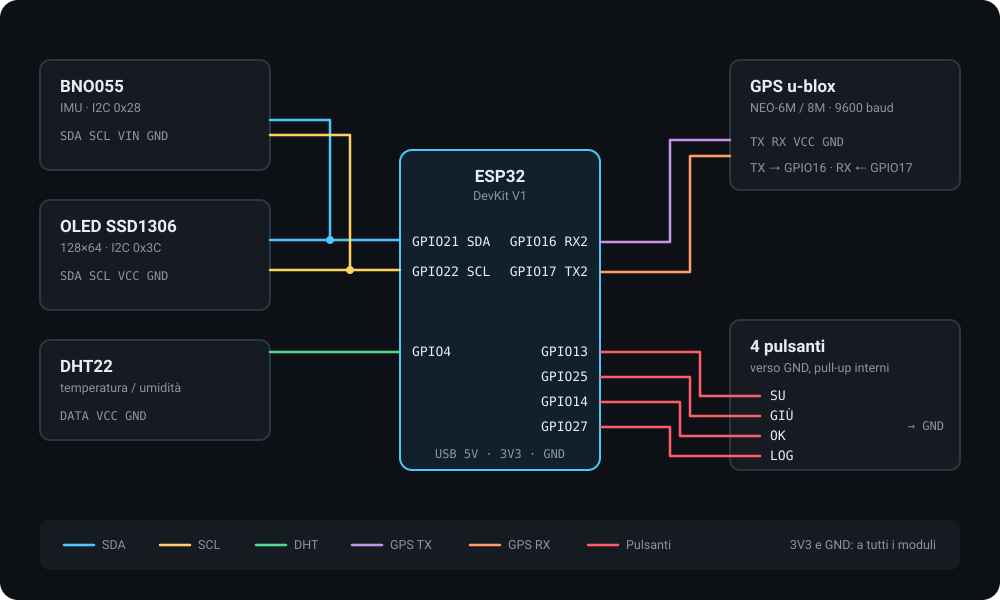

<details>
<summary>Il prototipo su breadboard</summary>

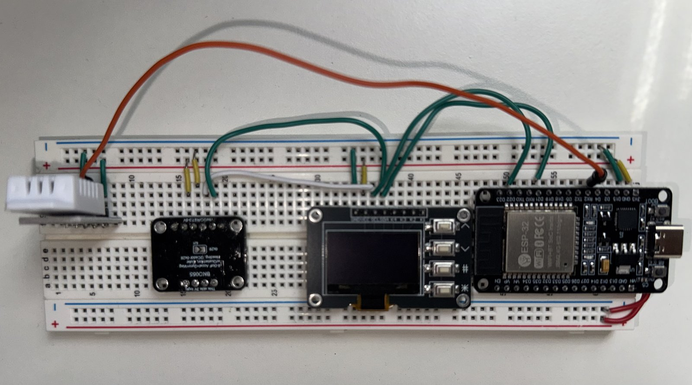

</details>

<a id="it-avvio"></a>
### Avvio rapido

1. **Apri lo sketch.** In Arduino IDE apri `WheelStat.ino`; la cartella deve chiamarsi esattamente `WheelStat`. Serve il core **esp32** di Espressif (3.x).
2. **Installa le librerie** dal Gestore librerie: `Adafruit BNO055`, `Adafruit SSD1306`, `Adafruit SH110X`, `Adafruit GFX Library`, `Adafruit Unified Sensor`, `DHT sensor library`, `TinyGPSPlus`. Solo se usi un BNO085: `Adafruit BNO08x`. I sensori meteo I2C e le altre IMU non hanno bisogno di librerie.
3. **Scegli la lingua** in [Config.h](Config.h): `LANG_IT` oppure `LANG_EN`.
4. **Carica** sulla scheda. Monitor seriale a 115200.
5. **Controlla l'avvio.** Il display elenca i cinque componenti con una spunta o una croce: sono controlli veri, un componente scollegato prende la croce. Poi chiede di calibrare il magnetometro muovendo la scatola a otto (OK per saltare).
6. **Controlla l'orientamento dell'IMU** prima di fidarti dei numeri: è il [paragrafo qui sotto](#it-orientamento). Tutte le altre prove, in ordine, sono in [docs/COLLAUDO.md](docs/COLLAUDO.md).

<p align="center">
  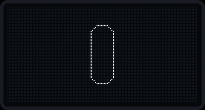
  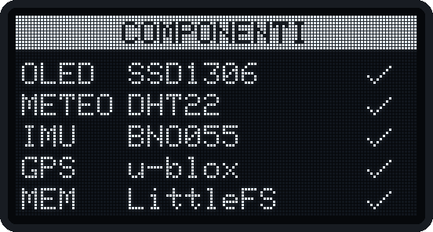
  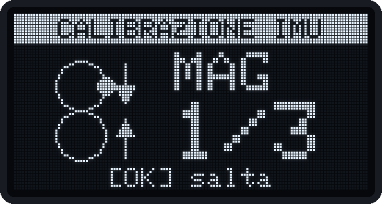
</p>

Da riga di comando:

```bash
arduino-cli compile --fqbn esp32:esp32:esp32doit-devkit-v1 .
```

Con **PlatformIO** (VS Code) c'è un [platformio.ini](platformio.ini) pronto che scarica le librerie da solo: `pio run -t upload`. Serve Python tra 3.10 e 3.14.

<a id="it-orientamento"></a>
### Orientamento dell'IMU

**Sbagliarlo non dà nessun errore: dà telemetria plausibile e sbagliata.** Va fatto una volta, con la scatola in mano, in [Config.h](Config.h).

**1. La posizione della basetta.** Scommenta una riga sola:

```cpp
#define IMU_MOUNT_UPSIDE_DOWN   // basetta capovolta (com'è montata la mia)
// #define IMU_MOUNT_UPRIGHT    // componenti in su, basetta in piano
// #define IMU_MOUNT_MANUAL     // nessuna delle due: scegli tu tra P0...P7
```

**2. I versi.** Accendi, muovi la scatola e controlla. Ogni riga sbagliata si corregge invertendo un segno:

| Muovi la scatola | Deve succedere | Se è al contrario |
|---|---|---|
| Inclinala a **destra** | la piega sale (pagina 0) | inverti `SIGN_LEAN` |
| Alza il **davanti** | compare `IMPENNATA`, non `STOPPIE` (pagina 3) | inverti `SIGN_PITCH` |
| Spingila in **avanti** | `Long` positivo, pallino in **alto** (pagina 2) | inverti `SIGN_G_LONG` |
| Spingila a **sinistra** | pallino a **sinistra** (pagina 2) | inverti `SIGN_G_LAT` |

Se due grandezze sono **scambiate** (la piega si muove quando alzi il muso) non è un segno: è il passo 1 da rifare.

**Con un'IMU diversa dal BNO055** i `SIGN_*` non contano: un verso sbagliato si corregge nella riga `IMU_AXES` di [Config.h](Config.h), che dice quale asse del chip punta avanti, a sinistra e in alto. Piega al contrario: cambia segno al secondo numero. Impennata al contrario: al primo e al terzo.

Sulla moto, da fermo e in piano, **OK sulla pagina 0 o 3** azzera piega e beccheggio per compensare un montaggio non in bolla. Va rifatto a ogni accensione.

<a id="it-oled"></a>
### Display

**SU/GIÙ** scorrono le pagine, **LOG** avvia e ferma la registrazione, **OK** fa una cosa diversa per pagina. La barra in alto mostra a colpo d'occhio cosa funziona: il GPS (un cerchio, col punto al centro quando c'è il fix) e i satelliti, una bandiera a scacchi se c'è un traguardo, il simbolo del WiFi quando è acceso e, mentre registri, un pallino lampeggiante col tempo di registrazione. Il tratto spesso sulla linea sotto il titolo dice in quale delle dieci pagine sei.

| # | Pagina | Cosa mostra | Tasto OK |
|---|---|---|---|
| 0 | **Piega** | Angolo di piega con il lato (freccia) e una barra che cresce da quella parte. Le due tacche sulla barra sono la soglia dell'allarme, che si stringe quando sale il rischio grip; oltre, il titolo diventa un avviso lampeggiante. Ai lati, la piega massima della sessione da ciascuna parte | Azzera |
| 1 | **Meteo** | Temperatura, umidità, rischio grip con barra | - |
| 2 | **Forza G** | G laterale e longitudinale, con mirino (l'anello interno è 0,5 G) e la scia dell'ultimo secondo | - |
| 3 | **Impennata / Stoppie** | Angolo di beccheggio | Azzera |
| 4 | **GPS** | Stato del fix, velocità, posizione, satelliti | - |
| 5 | **Giri** | Delta sul giro di riferimento (in negativo, testo scuro su fondo acceso, quando sei avanti), giro in corso col numero, ultimo, migliore | Segna il traguardo qui |
| 6-7 | **Record** | I massimi di sempre, per tracciato | - |
| 8 | **Memoria** | Quanto è piena, spazio libero, ore di registrazione che restano, file in scrittura | - |
| 9 | **WiFi** | Nome della rete, password, indirizzo del sito | Accende/spegne il WiFi |
| 10 | **QR del WiFi** | Solo a WiFi acceso: il QR da inquadrare col telefono per collegarsi | Spegne il WiFi |

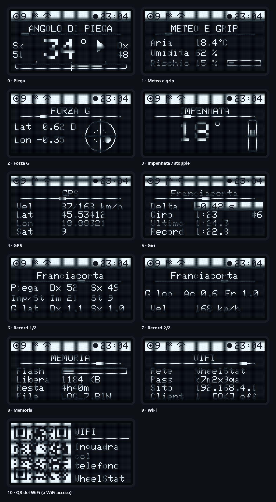

<p align="center">
  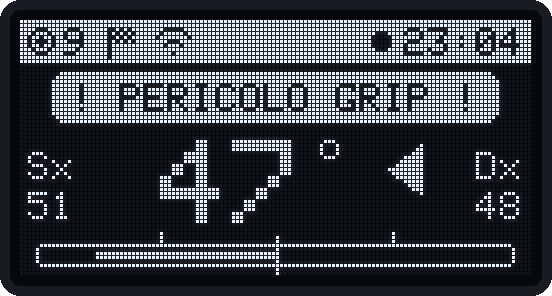
  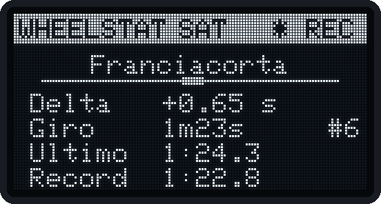
  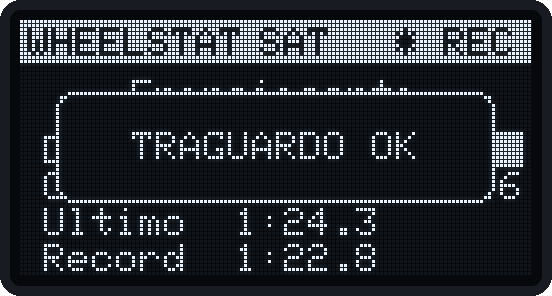
</p>

Fermando una registrazione compaiono tre schermate di riepilogo: massimi, durata, eventi. Un asterisco segna i record appena battuti.

<p align="center">
  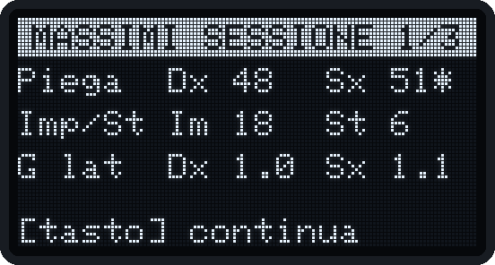
  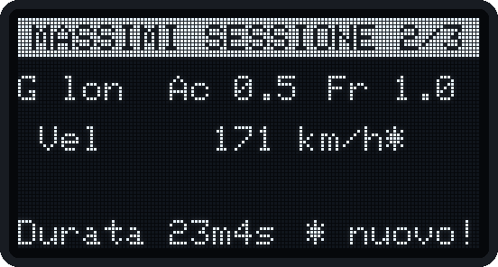
  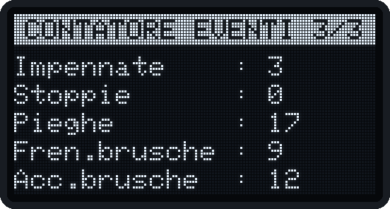
</p>

Le immagini del display sono generate dal codice vero delle schermate, compilato sul PC: `tools/oled-preview/build.ps1` le rifà dopo una modifica.

<a id="it-web"></a>
### Sito

Sulla pagina **WiFi** premi OK: l'ESP32 crea la sua rete. Passa alla pagina successiva e inquadra il QR con la fotocamera del telefono: si collega da solo, senza digitare la password. Appena collegato, il telefono propone di "accedere alla rete" e apre il sito. In alternativa collegati a mano alla rete `WheelStat` con la password che leggi sul display e apri **`http://192.168.4.1`**.

**La password non è nel codice.** Ogni dispositivo se ne inventa una la prima volta che accende il WiFi e la mostra sul display. Nome e password si cambiano dalle Impostazioni (fino a 12 caratteri, perché devono stare su una riga del display).

| Pagina | Cosa fa |
|---|---|
| **Sessioni** | Elenco delle registrazioni: grafici, download in CSV o GPX, elimina |
| **Grafici** | Una sessione: percorso colorato per piega, poi velocità, piega, impennata e forze G. Scegli un giro e scorri un grafico col dito per leggere i valori in quel punto. Scegliendo un secondo giro, i due si sovrappongono nello stesso punto della pista, con un grafico del distacco che mostra dove guadagni e dove perdi. Sotto, i tempi con i settori e il giro ideale |
| **Live** | Telemetria in tempo reale, percorso, delta sul giro |
| **Tracciati** | Crea e scegli i tracciati, intertempi, record, classifica |
| **Confronta** | Due sessioni affiancate, giro per giro |
| **Impostazioni** | Rete WiFi, campioni al secondo, soglie degli eventi, allarme di piega, aggiornamento del firmware |

La pagina Live dice se la connessione è caduta: senza, gli ultimi valori ricevuti resterebbero a schermo come se fossero attuali.

<p align="center">
  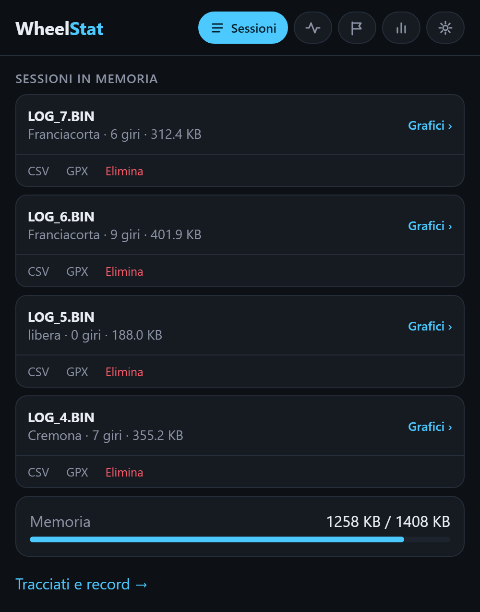
  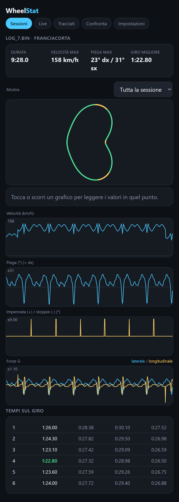
  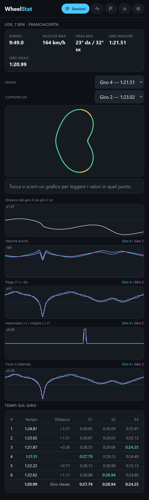
  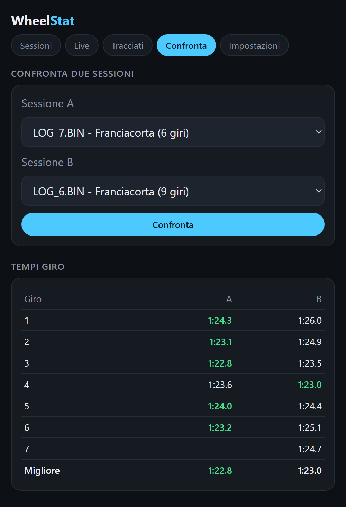
  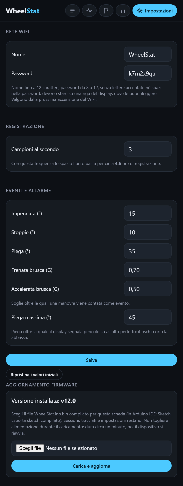
</p>

Durante una registrazione grafici, download e impostazioni sono bloccati: servire un file grande fermerebbe la telemetria.

**Aggiornare senza cavo.** Dalle Impostazioni carichi un nuovo firmware via WiFi: il file è `WheelStat.ino.bin` (Arduino IDE: *Sketch → Esporta sketch compilato*; PlatformIO: `.pio/build/esp32/firmware.bin`). Un file che non è un firmware per lo stesso chip viene rifiutato prima di scrivere, e quello in uso resta al suo posto finché il nuovo non è arrivato intero. Sessioni, tracciati e impostazioni restano.

<a id="it-giri"></a>
### Giri e tracciati

Fermati sul traguardo con il GPS agganciato e premi **OK sulla pagina Giri**, oppure crea un **tracciato** dal sito dandogli un nome: così traguardo, giro di riferimento e record restano salvati.

- **Il traguardo è una linea** di traverso alla pista, larga 20 m per lato. Tu segni solo il punto: il verso di marcia lo impara al primo passaggio sopra i 15 km/h e lo conferma al secondo. Da lì i passaggi contromano non contano, quindi una corsia di rientro accanto al traguardo non fa scattare il giro. Se il primo passaggio era nel verso sbagliato (stavi andando alla partenza), il successivo lo corregge e fa ripartire il cronometro.
- **Il tempo è calcolato tra una posizione GPS e la successiva**, nel punto in cui la linea viene attraversata, e sull'orologio del ricevitore: non è arrotondato ai 5 Hz del GPS.
- **Intertempi.** Ogni tracciato può avere fino a 2 punti intermedi, che dividono il giro in settori (almeno 15 secondi l'uno). Si aggiungono dal sito stando fermi sul punto.
- **Delta.** Il giro più veloce su un tracciato è tenuto punto per punto come riferimento. Mentre giri, la pagina Giri e il sito mostrano quanto sei avanti (`-`) o indietro (`+`) in quel punto della pista. A più di 30 m dalla traiettoria di riferimento il delta sparisce.
- **Settori e giro ideale.** Con gli intertempi, la pagina Live mostra i settori dell'ultimo giro col distacco dal migliore della sessione, e il giro ideale: la somma dei settori migliori, cioè il tempo che faresti mettendo insieme i tuoi tratti migliori.

<a id="it-misure"></a>
### Misure

**Filtro anti-buca.** Massimi, record ed eventi contano solo un livello *mantenuto* per 150 ms. L'urto di una buca dura 20-80 ms e non diventa un record di piega. I valori live restano non filtrati.

**Eventi.** Una manovra è contata quando supera la soglia, e ricontata solo dopo essere scesa sotto il 70% di essa. Le soglie si cambiano dalle Impostazioni; quelle iniziali:

| Evento | Soglia |
|---|---|
| Impennata | 15° |
| Stoppie | 10° |
| Piega (da entrambi i lati) | 35° |
| Frenata brusca | 0.70 G |
| Accelerata brusca | 0.50 G |

**Rischio grip.** Indice 0-100% che sale sopra il 55% di umidità e sotto i 20 °C. È una stima delle condizioni, non una misura di aderenza.

<a id="it-file"></a>
### Dati

Una sessione occupa **24 byte a campione, 3 campioni al secondo** (da 1 a 10, dalle Impostazioni): circa 260 KB l'ora, cinque ore nella memoria dati da 1,4 MB, centinaia su una **microSD** se ne monti una (le sessioni vanno lì da sole). Ogni campione porta il picco di piega, impennata e G del suo intervallo. I dati vanno sulla flash ogni 5 secondi: togliendo alimentazione si perdono al più quelli. A memoria piena la registrazione si chiude da sola.

Dal sito la sessione si scarica in **GPX** (il percorso, per Google Earth e simili) o in **CSV**:

```
Time_s,Lean,Pitch,G_Lat,G_Long,Speed_Kmh,Temp_C,Hum_%,Risk_%,Lat,Lon,Lap
0.00,-12.4,0.0,-0.31,0.12,64.2,18.4,62,15,45.4641100,9.1885400,1
0.33,-18.9,0.0,-0.47,0.05,66.0,18.4,62,15,45.4641350,9.1886120,1
...

TRACK,free
SUMMARY,Lean_R,...,Speed_Kmh,Duration_s
MAX,48.7,...,112,1384
EVENTS,Wheelies>15,Stoppies>10,Leans>35,HardBrakes>0.70G,HardAccels>0.50G
TOTAL,3,0,17,9,12

LAPS,Time_s
Lap_1,94.20*
```

`Lean` è positivo a destra, `Pitch` in impennata, `G_Lat` a destra, `G_Long` in accelerazione; l'asterisco segna il giro migliore. Il CSV è sempre in inglese, qualunque sia la lingua dell'interfaccia.

<a id="it-driver"></a>
### Altre schede e componenti

Il firmware gira su tutta la famiglia ESP32: la piedinatura segue la scheda selezionata nell'IDE.

| Chip | SU/GIÙ/OK/LOG | DHT | SDA/SCL | GPS RX/TX | Flash usata |
|---|---|---|---|---|---|
| **ESP32** (DevKit V1) | 13 / 25 / 14 / 27 | 4 | 21 / 22 | 16 / 17 | 93 % |
| **ESP32-S3** 🔧 | 5 / 6 / 7 / 15 | 4 | 8 / 9 | 18 / 17 | 87 % |
| **ESP32-S2** 🔧 | 5 / 6 / 7 / 15 | 4 | 8 / 9 | 18 / 17 | 84 % |
| **ESP32-C3** 🔧 | 3 / 4 / 5 / 6 | 10 | 8 / 9 | 0 / 1 | 96 % |

I componenti si **riconoscono da soli all'accensione**: monti quello che hai e la schermata d'avvio dice cosa ha trovato.

| Categoria | Componenti | Da impostare |
|---|---|---|
| Meteo | DHT22 · DHT11 🔧 · SHT4x 🔧 · SHT3x 🔧 · SHTC3 🔧 · HDC1080 🔧 · Si7021/HTU21D 🔧 · HTU31D 🔧 · AHT10/20/21 🔧 · AM2320 🔧 · BME280 🔧 | niente |
| IMU | BNO055 · BNO085/086 🔧 · ISM330DHCX 🔧 · LSM6DS3/DSL/DSO 🔧 · ICM-20948 🔧 · MPU6050/6500/9250 🔧 | il BNO085 si attiva in `Config.h` (libreria, ~10 KB); l'orientamento |
| GPS | u-blox 6/M8/M9/M10 · ATGM336H, Quectel L76K 🔧 · Quectel LC76G 🔧 · qualunque NMEA 🔧 | niente: velocità della seriale e 10 Hz li trova lui |
| Display | SSD1306 · SH1106 🔧 · SSD1309 🔧 · SH1107 🔧 (128×64, I2C o SPI) | il controller, in `Config.h` |
| Memoria | flash interna · microSD 🔧 | niente: se c'è una scheda, le sessioni vanno lì |

🔧 = compila, ma **non è mai stato provato su hardware**. Solo la configurazione della tabella [Cosa serve](#it-hardware) è montata e provata; confronta le piedinature con la serigrafia della tua scheda prima di saldare.

Dettagli, indirizzi I2C e trappole note: [docs/HARDWARE.md](docs/HARDWARE.md).

<a id="it-sviluppo"></a>
### Sviluppo

- [docs/COLLAUDO.md](docs/COLLAUDO.md): le prove da fare, dal banco alla pista, su una scatola o un firmware nuovi.
- [docs/ARCHITETTURA.md](docs/ARCHITETTURA.md): com'è organizzato il codice, il ciclo principale, i formati dei file.
- [docs/DRIVER.md](docs/DRIVER.md): come funzionano i driver e come aggiungerne uno.
- [docs/HARDWARE.md](docs/HARDWARE.md): compatibilità dei componenti, alimentazione dalla moto.
- [docs/CHANGELOG.md](docs/CHANGELOG.md): storico delle versioni.

La logica che non tocca l'hardware (traguardo, cronometro, delta, filtro anti-buca, formato del log) sta in `src/core/` e ha i suoi test, che girano sul PC senza la scheda:

```bash
pio test -e native
```

<a id="it-sicurezza"></a>
### ⚠️ Sicurezza

È uno strumento di **analisi dopo la guida**, non un aiuto alla guida. Non guardare il display in movimento e non usare il telefono in sella.

Il rischio grip è indicativo e non sostituisce la tua valutazione di asfalto e pneumatici. Fissa la scatola in modo solido, dove non interferisce con comandi e visuale.

### Licenza e autore

**Apache License 2.0**. Progettato e sviluppato da **Alessandro Rota**.

---

<a id="english"></a>
## 🇬🇧 English

**Motorcycle telemetry on an ESP32.** It measures lean, wheelies, G-forces, speed and lap times, and shows them on a small OLED and on a website the ESP32 serves to your phone by itself: no internet, no app.

[What it does](#en-what) · [What you need](#en-hardware) · [Quick start](#en-start) · [IMU orientation](#en-orientation) · [Display](#en-oled) · [Website](#en-web) · [Laps and tracks](#en-laps) · [Measurements](#en-measures) · [Data](#en-files) · [Other boards and components](#en-drivers) · [Development](#en-dev) · [Safety](#en-safety)

<a id="en-what"></a>
### What it does

- **Lean, wheelie/stoppie and G-forces** from an IMU (a BNO055 or one of about ten others), with a filter that throws away pothole hits and, for IMUs without fusion of their own, an attitude filter that uses the GPS speed so the lean is not lost in corners.
- **Speed, position and lap timing** from a GPS at up to 10 Hz: a finish line and up to two splits, with a **live delta** against your best lap.
- **Grip risk** estimated from temperature and humidity, which lowers the lean-alert threshold.
- **Recording to the internal flash**, three samples a second: about five hours, no SD card.
- **A website on your phone**: live telemetry, charts and a map of every session, session comparison, saved tracks, CSV and GPX download, settings and firmware update over WiFi.
- **Components recognised by themselves**: weather sensor, IMU, GPS and microSD are found at power-up, with nothing to configure.
- **Interface in Italian or English**, chosen at build time.

<p align="center">
  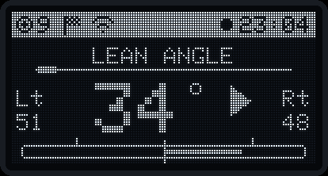
</p>

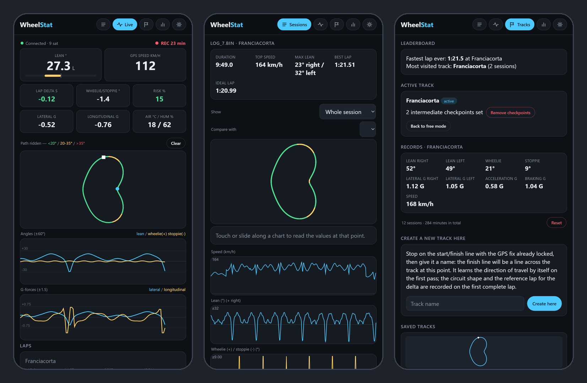

<a id="en-hardware"></a>
### What you need

| Component | Connection | Pins (ESP32 DevKit V1) | Notes |
|---|---|---|---|
| ESP32 DevKit V1 | - | - | Also S3, S2, C3: see [below](#en-drivers) |
| Bosch BNO055 IMU | I2C | SDA 21 / SCL 22 | Address `0x28` (`0x29` on some breakouts) |
| SSD1306 128×64 OLED | I2C | SDA 21 / SCL 22 | Address `0x3C` |
| DHT22 | GPIO | 4 | Temperature and humidity |
| u-blox NEO-6M / 8M GPS | UART2 | RX 16 / TX 17 | 9600 baud. **The module's TX goes to GPIO 16** |
| 4 buttons UP / DOWN / OK / LOG | GPIO | 13 / 25 / 14 / 27 | To GND, no resistors |

USB power on the bench; on the bike, from the switched 12 V through a 5 V converter and, if you like, an input that closes the session when you turn the key: [Power from the bike](docs/en/HARDWARE.md#power-from-the-bike-). Pins and addresses all live in [Config.h](Config.h).


<details>
<summary>The breadboard prototype</summary>


</details>

<a id="en-start"></a>
### Quick start

1. **Open the sketch.** In the Arduino IDE open `WheelStat.ino`; the folder must be named exactly `WheelStat`. You need Espressif's **esp32** core (3.x).
2. **Install the libraries** from the Library Manager: `Adafruit BNO055`, `Adafruit SSD1306`, `Adafruit SH110X`, `Adafruit GFX Library`, `Adafruit Unified Sensor`, `DHT sensor library`, `TinyGPSPlus`. Only for a BNO085: `Adafruit BNO08x`. The I2C weather sensors and the other IMUs need no library.
3. **Pick the language** in [Config.h](Config.h): `LANG_IT` or `LANG_EN`.
4. **Upload** to the board. Serial monitor at 115200.
5. **Watch the boot.** The display lists the five components with a tick or a cross: these are real checks, an unplugged component gets the cross. Then it asks you to calibrate the magnetometer by moving the box in a figure-eight (OK to skip).
6. **Check the IMU orientation** before trusting the numbers: it is the [next section](#en-orientation). All the other checks, in order, are in [docs/en/TESTING.md](docs/en/TESTING.md).

<p align="center">
  
  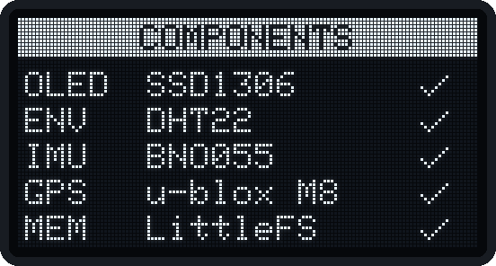
  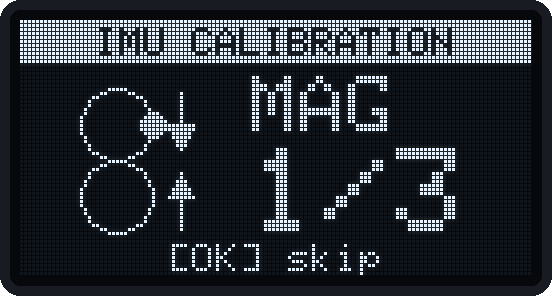
</p>

From the command line:

```bash
arduino-cli compile --fqbn esp32:esp32:esp32doit-devkit-v1 .
```

With **PlatformIO** (VS Code) there is a ready [platformio.ini](platformio.ini) that downloads the libraries by itself: `pio run -t upload`. It needs Python 3.10 to 3.14.

<a id="en-orientation"></a>
### IMU orientation

**Getting it wrong raises no error: it produces plausible, wrong telemetry.** Do it once, with the box in your hand, in [Config.h](Config.h).

**1. How the board sits.** Uncomment one line only:

```cpp
#define IMU_MOUNT_UPSIDE_DOWN   // board upside down (how mine is built)
// #define IMU_MOUNT_UPRIGHT    // components up, board flat
// #define IMU_MOUNT_MANUAL     // neither: pick one of P0...P7 yourself
```

**2. The directions.** Power up, move the box and check. Any wrong row is fixed by flipping one sign:

| Move the box | What should happen | If it is reversed |
|---|---|---|
| Lean it **right** | lean rises (page 0) | flip `SIGN_LEAN` |
| Lift the **front** | `WHEELIE` shows, not `STOPPIE` (page 3) | flip `SIGN_PITCH` |
| Push it **forward** | `Long` positive, dot goes **up** (page 2) | flip `SIGN_G_LONG` |
| Push it **left** | dot goes **left** (page 2) | flip `SIGN_G_LAT` |

If two quantities are **swapped** (lean moves when you lift the nose) that is not a sign: redo step 1.

**With an IMU other than the BNO055** the `SIGN_*` do not count: a wrong direction is fixed in the `IMU_AXES` line of [Config.h](Config.h), which says which chip axis points forward, left and up. Lean reversed: flip the sign of the second number. Wheelie reversed: of the first and the third.

On the bike, stopped and level, **OK on page 0 or 3** zeroes lean and pitch to make up for a box that is not level. It has to be redone at every power-up.

<a id="en-oled"></a>
### Display

**UP/DOWN** scroll the pages, **LOG** starts and stops recording, **OK** does a different job per page. The top bar shows at a glance what is working: the GPS (a ring, with a dot in the middle once there is a fix) and the satellites, a chequered flag when a finish line is set, the WiFi symbol when it is on and, while recording, a blinking dot with the recording time. The thick stretch on the line under the title tells which of the ten pages you are on.

| # | Page | What it shows | OK button |
|---|---|---|---|
| 0 | **Lean** | Lean angle with its side (arrow) and a bar growing that way. The two notches on the bar are the alert threshold, which tightens as grip risk rises; past it the title becomes a blinking warning. At the sides, the session's maximum lean on each side | Zero |
| 1 | **Weather** | Temperature, humidity, grip risk with a gauge | - |
| 2 | **G-force** | Lateral and longitudinal G, with a crosshair (the inner ring is 0.5 G) and the trail of the last second | - |
| 3 | **Wheelie / Stoppie** | Pitch angle | Zero |
| 4 | **GPS** | Fix status, speed, position, satellites | - |
| 5 | **Laps** | Delta against the reference lap (in reverse video, dark on a lit box, when you are ahead), current lap with its number, last, best | Marks the finish line here |
| 6-7 | **Records** | All-time maxima, per track | - |
| 8 | **Storage** | How full it is, free space, hours of recording left, file being written | - |
| 9 | **WiFi** | Network name, password, site address | WiFi on/off |
| 10 | **WiFi QR** | Only with the WiFi on: the QR code to scan with the phone to connect | WiFi off |

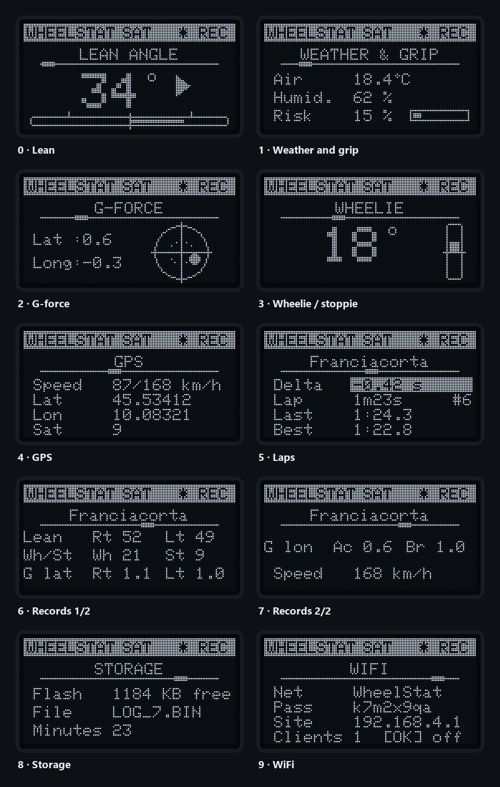

<p align="center">
  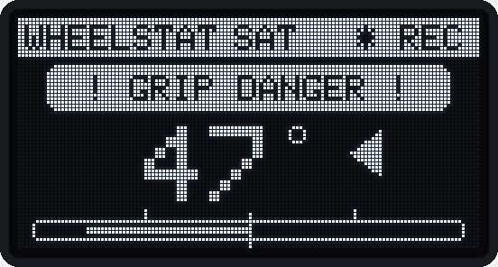
  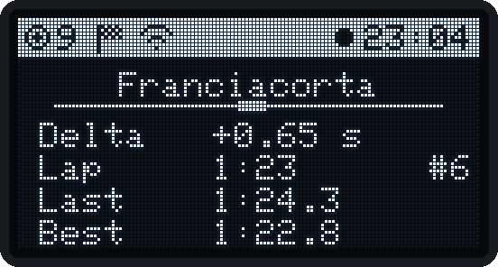
  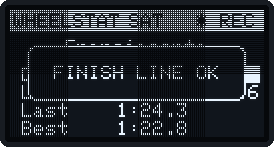
</p>

Stopping a recording brings up three summary screens: maxima, duration, events. An asterisk marks records just beaten.

<p align="center">
  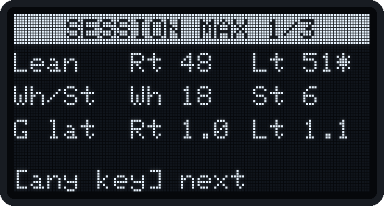
  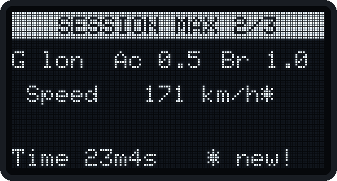
  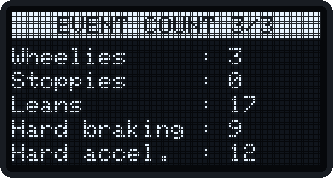
</p>

The display images are generated from the real screen code, compiled on a PC: `tools/oled-preview/build.ps1` redoes them after a change.

<a id="en-web"></a>
### Website

On the **WiFi** page press OK: the ESP32 creates its own network. Go to the next page and point the phone's camera at the QR code: it joins by itself, with no password to type. Once connected, the phone offers to "sign in to the network" and opens the website. Or join `WheelStat` by hand with the password shown on the display and open **`http://192.168.4.1`**.

**The password is not in the code.** Each device makes one up the first time it switches the WiFi on and shows it on the display. Name and password can be changed from Settings (up to 12 characters, because they must fit on one row of the display).

| Page | What it does |
|---|---|
| **Sessions** | List of recordings: charts, CSV or GPX download, delete |
| **Charts** | One session: path coloured by lean, then speed, lean, wheelie and G-forces. Pick a lap and slide a finger along a chart to read the values at that point. Pick a second lap and the two are overlaid at the same point of the track, with a gap chart showing where you gain and where you lose. Below, the times with sectors and the ideal lap |
| **Live** | Real-time telemetry, path, lap delta |
| **Tracks** | Create and select tracks, splits, records, leaderboard |
| **Compare** | Two sessions side by side, lap by lap |
| **Settings** | WiFi network, samples per second, event thresholds, lean alert, firmware update |

The Live page tells when the connection drops: otherwise the last values received would stay on screen looking current.

<p align="center">
  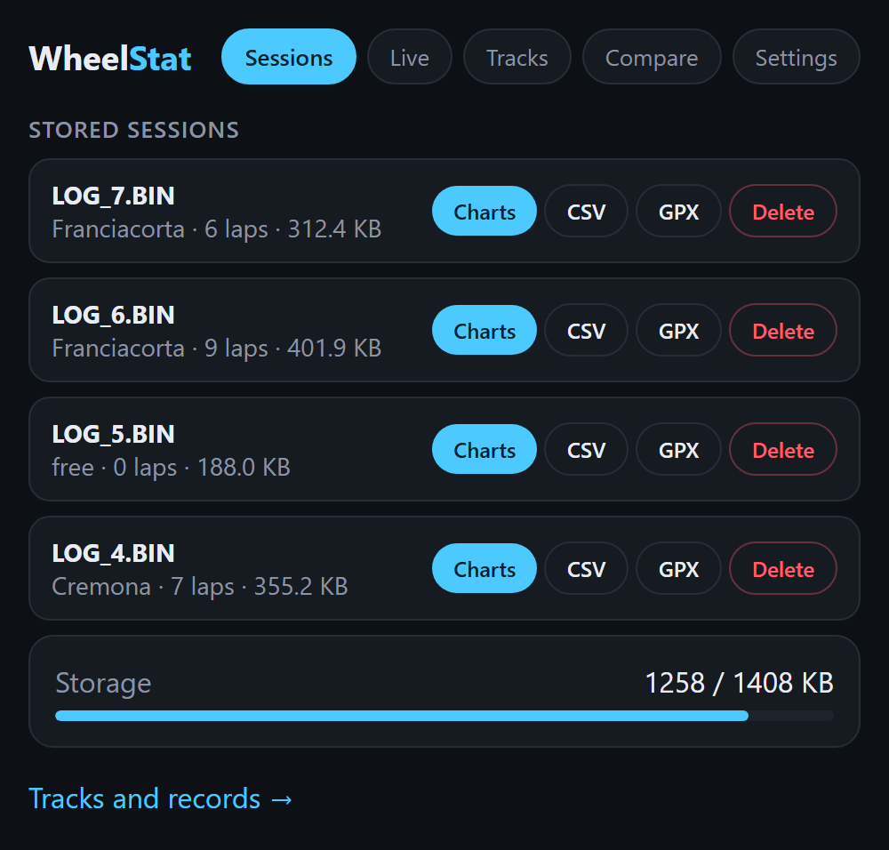
  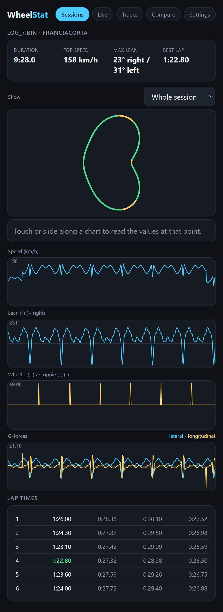
  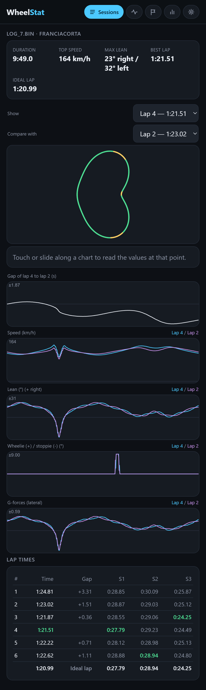
  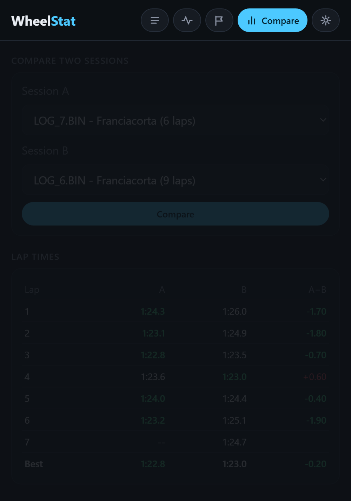
  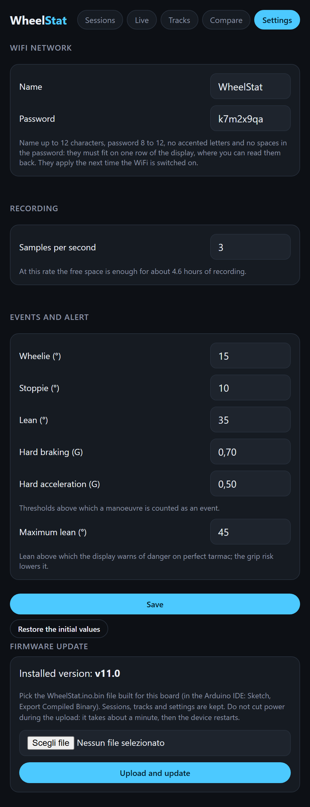
</p>

While recording, charts, downloads and settings are blocked: serving a large file would stall the telemetry.

**Updating without a cable.** Settings uploads a new firmware over WiFi: the file is `WheelStat.ino.bin` (Arduino IDE: *Sketch → Export Compiled Binary*; PlatformIO: `.pio/build/esp32/firmware.bin`). A file that is not a firmware for the same chip is refused before anything is written, and the running one stays in place until the new one has arrived whole. Sessions, tracks and settings are kept.

<a id="en-laps"></a>
### Laps and tracks

Stop on the finish line with a GPS fix and press **OK on the Laps page**, or create a **track** from the website and name it: that way the line, the reference lap and the records are saved.

- **The finish is a line** across the track, 20 m wide on each side. You only mark the point: the direction of travel is learned from the first pass above 15 km/h and confirmed by the second. From then on passes the wrong way do not count, so a return lane next to the line does not trigger a lap. If the first pass was the wrong way (you were riding to the start), the next one corrects it and restarts the stopwatch.
- **The time is worked out between one GPS position and the next**, at the point where the line is crossed, and on the receiver's own clock: it is not rounded to the GPS's 5 Hz.
- **Splits.** Each track can have up to 2 intermediate points, dividing the lap into sectors (at least 15 seconds each). Add them from the website while standing on the spot.
- **Delta.** The fastest lap on a track is kept point by point as the reference. While you ride, the Laps page and the website show how far ahead (`-`) or behind (`+`) you are at that point of the track. More than 30 m off the reference line the delta disappears.
- **Sectors and ideal lap.** With splits, the Live page shows the sectors of the last lap with the gap to the session's best, and the ideal lap: the sum of the best sectors, the time you would ride by putting your best stretches together.

<a id="en-measures"></a>
### Measurements

**Pothole filter.** Maxima, records and events only count a level *held* for 150 ms. A pothole hit lasts 20-80 ms and never becomes a lean record. Live values stay unfiltered.

**Events.** A manoeuvre is counted when it crosses the threshold, and counted again only after dropping below 70% of it. Thresholds can be changed from Settings; the initial ones:

| Event | Threshold |
|---|---|
| Wheelie | 15° |
| Stoppie | 10° |
| Lean (either side) | 35° |
| Hard braking | 0.70 G |
| Hard acceleration | 0.50 G |

**Grip risk.** A 0-100% index that rises above 55% humidity and below 20 °C. An estimate of conditions, not a measurement of traction.

<a id="en-files"></a>
### Data

A session takes **24 bytes per sample, 3 samples a second** (1 to 10, from Settings): about 260 KB an hour, five hours in the 1.4 MB data area, hundreds on a **microSD** if you fit one (sessions go there by themselves). Each sample carries the peak of lean, wheelie and G over its interval. Data reaches the flash every 5 seconds: cutting power loses those at most. When the storage is full the recording closes by itself.

The website exports a session as **GPX** (the path, for Google Earth and the like) or **CSV**:

```
Time_s,Lean,Pitch,G_Lat,G_Long,Speed_Kmh,Temp_C,Hum_%,Risk_%,Lat,Lon,Lap
0.00,-12.4,0.0,-0.31,0.12,64.2,18.4,62,15,45.4641100,9.1885400,1
0.33,-18.9,0.0,-0.47,0.05,66.0,18.4,62,15,45.4641350,9.1886120,1
...

TRACK,free
SUMMARY,Lean_R,...,Speed_Kmh,Duration_s
MAX,48.7,...,112,1384
EVENTS,Wheelies>15,Stoppies>10,Leans>35,HardBrakes>0.70G,HardAccels>0.50G
TOTAL,3,0,17,9,12

LAPS,Time_s
Lap_1,94.20*
```

`Lean` is positive to the right, `Pitch` in a wheelie, `G_Lat` to the right, `G_Long` when accelerating; the asterisk marks the best lap. The CSV is always in English, whatever the interface language.

<a id="en-drivers"></a>
### Other boards and components

The firmware runs on the whole ESP32 family: the pinout follows the board selected in the IDE.

| Chip | UP/DOWN/OK/LOG | DHT | SDA/SCL | GPS RX/TX | Flash used |
|---|---|---|---|---|---|
| **ESP32** (DevKit V1) | 13 / 25 / 14 / 27 | 4 | 21 / 22 | 16 / 17 | 93 % |
| **ESP32-S3** 🔧 | 5 / 6 / 7 / 15 | 4 | 8 / 9 | 18 / 17 | 87 % |
| **ESP32-S2** 🔧 | 5 / 6 / 7 / 15 | 4 | 8 / 9 | 18 / 17 | 84 % |
| **ESP32-C3** 🔧 | 3 / 4 / 5 / 6 | 10 | 8 / 9 | 0 / 1 | 96 % |

Components are **recognised by themselves at power-up**: fit what you have and the boot screen says what it found.

| Category | Components | To set |
|---|---|---|
| Weather | DHT22 · DHT11 🔧 · SHT4x 🔧 · SHT3x 🔧 · SHTC3 🔧 · HDC1080 🔧 · Si7021/HTU21D 🔧 · HTU31D 🔧 · AHT10/20/21 🔧 · AM2320 🔧 · BME280 🔧 | nothing |
| IMU | BNO055 · BNO085/086 🔧 · ISM330DHCX 🔧 · LSM6DS3/DSL/DSO 🔧 · ICM-20948 🔧 · MPU6050/6500/9250 🔧 | the BNO085 is turned on in `Config.h` (library, ~10 KB); the orientation |
| GPS | u-blox 6/M8/M9/M10 · ATGM336H, Quectel L76K 🔧 · Quectel LC76G 🔧 · any NMEA 🔧 | nothing: it finds the serial speed and 10 Hz by itself |
| Display | SSD1306 · SH1106 🔧 · SSD1309 🔧 · SH1107 🔧 (128×64, I2C or SPI) | the controller, in `Config.h` |
| Storage | internal flash · microSD 🔧 | nothing: with a card in, sessions go there |

🔧 = it compiles, but **has never been tried on hardware**. Only the setup in the [What you need](#en-hardware) table is built and tested; check a pinout against your board's silkscreen before soldering.

Details, I2C addresses and known traps: [docs/en/HARDWARE.md](docs/en/HARDWARE.md).

<a id="en-dev"></a>
### Development

- [docs/en/TESTING.md](docs/en/TESTING.md): the checks to run, from the bench to the track, on a new box or firmware.
- [docs/en/ARCHITECTURE.md](docs/en/ARCHITECTURE.md): how the code is organised, the main loop, the file formats.
- [docs/en/DRIVERS.md](docs/en/DRIVERS.md): how the drivers work and how to add one.
- [docs/en/HARDWARE.md](docs/en/HARDWARE.md): component compatibility, power from the bike.
- [docs/CHANGELOG.md](docs/CHANGELOG.md): version history (in Italian).

The logic that never touches the hardware (finish line, lap timer, delta, pothole filter, log format) lives in `src/core/` and has its own tests, which run on a PC with no board:

```bash
pio test -e native
```

<a id="en-safety"></a>
### ⚠️ Safety

This is a tool for **analysis after the ride**, not a riding aid. Do not look at the display while moving and do not use the phone in the saddle.

The grip risk is indicative and does not replace your own judgement of tarmac and tyres. Fix the box solidly, where it does not get in the way of controls or view.

### License and author

**Apache License 2.0**. Designed and developed by **Alessandro Rota**.
