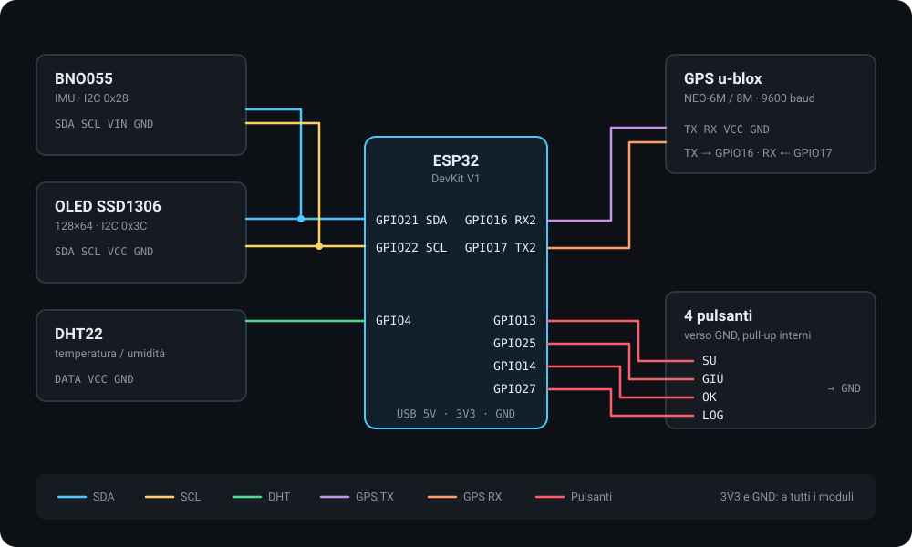

# Compatibilità hardware

Quali componenti funzionano, come li riconosce il firmware e cosa va controllato al primo montaggio. Come sono fatti i driver è in [DRIVER.md](DRIVER.md).

*English version: [en/HARDWARE.md](en/HARDWARE.md).*

> **Stato delle verifiche.** Solo la configurazione montata è provata su hardware reale. Gli altri componenti sono scritti seguendo i loro datasheet, i calcoli (conversioni, checksum, filtro d'assetto) sono verificati sul PC e tutto è **verificato in compilazione**, ma non sul campo. Le righe segnate 🔧 sono quelle mai provate fisicamente: al primo montaggio segui [COLLAUDO.md](COLLAUDO.md).

---

## Configurazione montata

| Categoria | Componente | Bus | Indirizzo / Pin |
|---|---|---|---|
| MCU | ESP32 DevKit V1 | - | - |
| IMU | Bosch BNO055 | I2C | `0x28` |
| Display | OLED SSD1306 128×64 | I2C | `0x3C` |
| Meteo | DHT22 / AM2302 | one-wire | GPIO 4 |
| GPS | u-blox NEO-6M / NEO-8M | UART2 | GPIO 16/17 |
| Pulsanti | 4× tattili | GPIO | 13 / 25 / 14 / 27 |



## Riconosciuti da soli

**Non si sceglie niente in `Config.h`** per il sensore meteo, l'IMU, il GPS, l'indirizzo del display e la microSD: all'accensione il firmware li cerca e usa quello che risponde. La schermata d'avvio mostra il nome di ciò che ha trovato, il monitor seriale qualche dettaglio in più (per il GPS la velocità della seriale e i report al secondo ottenuti).

In `Config.h` restano solo le cose che non si possono chiedere al componente: il controller del display, se il display è su SPI, quali IMU con libreria includere, e la posizione dell'IMU nella scatola.

---

## Microcontrollore: quale ESP32

Il firmware gira su tutta la famiglia. Cambiano i **numeri GPIO**: sull'S3 e sul C3 i pin 22, 25 e 27 del DevKit V1 non esistono affatto, e il C3 ha due UART invece di tre. `Config.h` ha quindi quattro piedinature, scelte dal preprocessore con le macro `CONFIG_IDF_TARGET_*` del core: basta selezionare la board nell'IDE.

| Chip | Stato | SU/GIÙ/OK/LOG | DHT | SDA/SCL | GPS RX/TX | SPI SCK/MISO/MOSI, CS microSD | Flash |
|---|---|---|---|---|---|---|---|
| **ESP32** (DevKit V1, WROOM, WROVER) | montato | 13 / 25 / 14 / 27 | 4 | 21 / 22 | 16 / 17 | 18 / 19 / 23, 5 | 1224886 B (93 %) |
| **ESP32-S3** | 🔧 | 5 / 6 / 7 / 15 | 4 | 8 / 9 | 18 / 17 | 12 / 13 / 11, 10 | ~87 % (v11.1) |
| **ESP32-S2** | 🔧 | 5 / 6 / 7 / 15 | 4 | 8 / 9 | 18 / 17 | 12 / 13 / 11, 10 | ~84 % (v11.1) |
| **ESP32-C3** | 🔧 | 3 / 4 / 5 / 6 | 10 | 8 / 9 | 0 / 1 | - (niente microSD) | 1267021 B (**96 %**) |

Le piedinature 🔧 compilano e rispettano i vincoli del chip, ma **nessuna è mai stata cablata**: prima di saldare, confrontale con la serigrafia della tua board.

**Il C3 è al 96% della flash**: è il core RISC-V, ~80 KB in più a parità di sorgente, e restano circa 45 KB. Sulle altre schede la microSD costa ~43 KB (sull'ESP32 classico: 90% senza, 93% con). S3 e S2 sono le misure della v11.1: con questa versione salgono di qualche punto.

**Vincoli da rispettare se cambi i pin:**

- **strapping**, decidono la modalità di boot: un *pulsante* premuto all'accensione impedirebbe l'avvio. Sono `0, 2, 12, 15` (ESP32), `0, 3, 45, 46` (S3), `0, 45, 46` (S2), `2, 8, 9` (C3). L'**I2C ci può stare**: le pull-up tengono le linee alte a riposo, che è lo stato di boot normale, come SDA/SCL sul C3;
- **flash SPI interna**: `6-11` (ESP32), `26-32` (S2), `12-17` (molti moduli C3);
- **USB nativo**: `19/20` (S2, S3), `18/19` (C3).

Due trappole:

- **C3 e S2 hanno due sole UART** e la 0 è del monitor seriale: al GPS resta la 1 (`GPS_UART_NUM`). Scriverci 2 non dà errore di compilazione, dà una seriale muta, cioè un GPS che risulta assente senza motivo apparente.
- **Sull'ESP32 classico i GPIO 34-39 sono solo input e senza pull-up interna:** inutilizzabili per i pulsanti così come sono cablati. È l'errore facile cercando pin liberi su una board da 38 pin.

Per una board non prevista si copia il blocco più vicino in `Config.h`.

---

## Mappa del bus I2C: controllare prima di comprare

Display, IMU e sensore meteo I2C condividono **lo stesso bus** (SDA 21 / SCL 22 sull'ESP32 classico, 8 / 9 sulle altre varianti). Il firmware trova da solo l'indirizzo di ognuno, ma **due componenti sullo stesso indirizzo non funzionano**: di solito ne sparisce uno, apparentemente a caso.

| Indirizzo | Componenti |
|---|---|
| `0x28` / `0x29` | BNO055 |
| `0x38` | AHT10 / AHT20 / AHT21 / AHT25 |
| `0x3C` / `0x3D` | display OLED |
| `0x40` | HDC1080, Si7021, HTU21D, SHT21, HTU31D (uno solo per volta) |
| `0x41` | HTU31D con ADDR alto |
| `0x44` / `0x45` | SHT4x (solo `0x44`), SHT3x |
| `0x4A` / `0x4B` | BNO085 / BNO086 |
| `0x5C` | AM2320 |
| `0x68` / `0x69` | MPU6050 e famiglia, ICM-20948 |
| `0x6A` / `0x6B` | LSM6DS3 / DSL / DSO / DSOX, ISM330DHCX |
| `0x70` | SHTC3 |
| `0x76` / `0x77` | BME280 |

Dove due chip condividono un indirizzo (`0x40`, `0x44`, `0x68`) il firmware li distingue da un registro d'identità o dal CRC della loro risposta, e li prova in un ordine preciso: [DRIVER.md](DRIVER.md#il-riconoscimento). Nessuna combinazione di un display, un'IMU e un sensore meteo di questa tabella si scontra.

---

## Sensore meteo

Tutti letti **senza libreria**, tranne il DHT: il firmware parla direttamente col chip, con le formule di conversione del datasheet (verificate sul PC in `src/core/SensorMath`). Uno vale l'altro: il primo che risponde viene usato.

| Componente | Stato | Bus | Indirizzo | Note |
|---|---|---|---|---|
| **DHT22 / AM2302** | montato | one-wire | GPIO 4 | Letto ogni 2 s: più spesso ripete l'ultimo valore |
| **DHT11** | 🔧 | one-wire | GPIO 4 | Riconosciuto dal formato della risposta. Precisione scarsa (±2 °C, ±5 %), interi |
| **Sensirion SHT4x** (SHT40/41/45) | 🔧 **consigliato** | I2C | `0x44` | La generazione attuale: ±1,8 %RH, ±0,2 °C. **Se compri oggi, è questo.** Riscaldatore tenuto spento: scalderebbe il sensore falsando la temperatura da cui dipende il rischio grip |
| **Sensirion SHT3x** (SHT30/31/35) | 🔧 | I2C | `0x44` / `0x45` | Generazione precedente: ±2 %RH, ±0,3 °C |
| **Sensirion SHTC3** | 🔧 | I2C | `0x70` | Piccolo ed economico, ±2 %RH, ±0,2 °C |
| **TI HDC1080** | 🔧 | I2C | `0x40` | ±2 %RH, ±0,2 °C |
| **Si7021 / HTU21D / SHT21** | 🔧 | I2C | `0x40` | Classici, compatibili tra loro |
| **TE HTU31D** | 🔧 | I2C | `0x40` / `0x41` | Paragonabile allo SHT3x a costo minore |
| **AHT10 / AHT20 / AHT21 / AHT25** | 🔧 | I2C | `0x38` | I più economici: lo scarto dal riferimento **varia con la temperatura** e tende a leggere alto. Va bene per un indice indicativo come il rischio grip |
| **Aosong AM2320** | 🔧 | I2C | `0x5C` | La versione I2C del DHT22 |
| **Bosch BME280** | 🔧 | I2C | `0x76` / `0x77` | Misura anche la pressione, che il firmware ignora |

> ⚠️ **Trappola BME280 / BMP280.** Sono identici d'aspetto e hanno **lo stesso indirizzo**, ma il BMP280 non ha il sensore di umidità. È una delle sostituzioni sbagliate più comuni nei moduli venduti online. Per questo progetto non è un dettaglio: **l'umidità è metà della formula del rischio grip**. Il firmware riconosce il BMP280 dal suo chip-ID e lo spiega sul monitor seriale invece di ignorarlo in silenzio.

**Requisito della categoria:** temperatura *e* umidità. Un sensore di sola temperatura non è un'alternativa parziale: senza umidità il rischio grip non si calcola.

---

## IMU

| Componente | Stato | Indirizzo | Libreria | Note |
|---|---|---|---|---|
| **Bosch BNO055** | montato | `0x28` / `0x29` | Adafruit BNO055 | Fusione nel chip. Fuori produzione: vedi sotto |
| **BNO085 / BNO086** | 🔧 **consigliato** | `0x4A` / `0x4B` | Adafruit BNO08x | Il successore del BNO055. Da attivare in `Config.h` (`IMU_WITH_BNO08X`): la sua libreria occupa ~10 KB di flash |
| **ISM330DHCX** | 🔧 | `0x6A` / `0x6B` | nessuna | Versione industriale dell'LSM6DSO: la più robusta alle vibrazioni |
| **LSM6DS3 / DSL / DSO / DSOX** | 🔧 | `0x6A` / `0x6B` | nessuna | Comuni sulle schede Adafruit e SparkFun |
| **ICM-20948** | 🔧 | `0x68` / `0x69` | nessuna | Il successore dell'MPU9250; il magnetometro non è usato |
| **MPU6050 / MPU6500 / MPU9250** | 🔧 | `0x68` / `0x69` | nessuna | Il più diffuso (GY-521). Economico ma rumoroso: va fissato rigido |
| **ICM-20602 / ICM-20689** | 🔧 | `0x68` / `0x69` | nessuna | Stessi registri dell'MPU6500 |

### Due modi di avere l'assetto

- **Il BNO055** fa tutto nel chip e consegna angoli già pronti: è il percorso con cui il firmware è nato ed è stato provato, e resta così.
- **Tutte le altre** consegnano accelerometro e giroscopio grezzi, e l'assetto lo calcola il firmware con un filtro di Madgwick (`src/core/Ahrs`). **Anche il BNO085**, che saprebbe farlo da sé: la sua fusione non conosce la velocità della moto, e senza velocità in curva la piega non si vede (sotto).

**Perché serve la velocità.** In una curva costante la moto si piega in modo che gravità e forza centrifuga, sommate, cadano lungo il suo piano: l'accelerometro "vede" la gravità dritta verso il basso della moto, e un filtro che si fida di lui legge una piega vicina a zero. Lo stesso succede al beccheggio in frenata. Il filtro del firmware toglie dall'accelerometro ciò che il moto ci mette, calcolato dalla velocità del GPS e dal giroscopio (avanti: la variazione di velocità; di lato: velocità per velocità di imbardata), e quello che resta è la gravità. I test sul PC simulano una curva a 20° e a 40° e una frenata: con la correzione la piega torna entro un grado, senza a 20° si perde. Senza fix GPS la correzione semplicemente non c'è.

All'avvio le IMU senza fusione misurano per un secondo lo **zero del giroscopio** (lo scarto che ha anche da ferma): la scatola deve stare ferma durante la schermata d'avvio.

### La posizione nella scatola

Per il BNO055 la decide `IMU_BNO055_REMAP`, per tutte le altre `IMU_AXES` in `Config.h`: quale asse del chip punta in avanti, a sinistra e in alto. Le posizioni `IMU_MOUNT_UPRIGHT` e `IMU_MOUNT_UPSIDE_DOWN` le impostano entrambe, supponendo l'asse X del chip (stampato su quasi tutti i breakout) verso la parte anteriore. Le quattro prove del README dicono se è giusto.

---

## Display OLED

L'**indirizzo** (`0x3C` o `0x3D`) lo trova il firmware. Il **controller** no: pannelli diversi rispondono allo stesso indirizzo, quindi si sceglie in `Config.h`.

| Componente | Stato | Macro | Note |
|---|---|---|---|
| **SSD1306 128×64** | montato | `DISPLAY_SSD1306` | I classici da 0,96" |
| **SH1106 128×64** | 🔧 | `DISPLAY_SH1106` | Di solito i moduli da 1,3". Layout identico al pixel |
| **SSD1309 128×64** | 🔧 | `DISPLAY_SSD1309` | Pannelli più grandi (2,42"); stesso driver dell'SSD1306 |
| **SH1107 128×64** | 🔧 | `DISPLAY_SH1107` | ⚠️ La maggior parte dei moduli SH1107 è 128×128: non supportati |
| **SSD1306 128×32**, **128×128** | ❌ | - | Il layout è disegnato a mano per 128×64: su 32 righe tre righe di dati non ci stanno |

**Su SPI** (`DISPLAY_SPI` in `Config.h`): SSD1306 e SH1106 esistono anche in versione SPI, a sette pin. È più veloce, ma su SPI non c'è modo di chiedere se il pannello c'è, quindi viene dato per presente. I pin CS, DC e RST sono in `Config.h`; il bus è lo stesso della microSD. Non sul C3, che non ha pin liberi.

> **Se compri un OLED "SSD1306" e l'immagine appare spostata di due pixel, o con una colonna di rumore sul bordo, non è rotto: è un SH1106.** Succede spesso: quel controller viene rivenduto sotto il nome più noto. Si risolve con `DISPLAY_SH1106`.

---

## GPS

Il firmware trova da solo la velocità della seriale (9600, 38400, 115200, 57600), la famiglia del modulo e la configura per la frequenza più alta che regge. Poi **misura** quanti report al secondo arrivano davvero e regola su quello il tempo dopo cui il fix è considerato perso.

| Componente | Stato | Famiglia | Frequenza |
|---|---|---|---|
| **u-blox NEO-6M** | montato | u-blox, comandi vecchi | 5 Hz (il chip non va oltre) |
| **u-blox NEO-M8N, Beitian BN-220 / BN-880** | 🔧 **consigliato** | u-blox, comandi vecchi | 10 Hz |
| **u-blox NEO-M9N** | 🔧 | u-blox, comandi vecchi | 10 Hz |
| **u-blox MAX-M10S, Beitian serie M10** | 🔧 | u-blox, chiavi CFG-VALSET | 10 Hz |
| **ATGM336H, Quectel L76K** | 🔧 | CASIC (`$PCAS`) | 10 Hz |
| **Quectel LC76G / LC86G / LC29H** | 🔧 | Airoha (`$PAIR`) | 10 Hz |
| **Qualunque altro modulo NMEA** | 🔧 | - | Quella di fabbrica, di solito 1 Hz |

**Come riconosce la famiglia.** Chiede al modulo la sua versione col protocollo UBX: se risponde è un u-blox, e la versione hardware dice se vuole i messaggi di configurazione vecchi (fino all'M9) o le chiavi nuove (M10: quelli vecchi sono stati tolti). Se non risponde, manda i comandi delle due famiglie CASIC e Airoha: ognuna ignora quelli dell'altra. In tutti i casi spegne le frasi NMEA inutili, porta la seriale a 115200 (a 9600 i 10 Hz non ci stanno) e chiede 10 Hz, o 5 se il modulo rifiuta.

**Cosa cambia la frequenza.** A 100 km/h tra due posizioni ci sono 2,8 m a 10 Hz, 5,6 m a 5 Hz, 28 m a 1 Hz. Il passaggio sul traguardo è interpolato fra le due posizioni, ma più sono vicine più l'ipotesi di velocità costante regge: i tempi sul giro sono più precisi e il delta si aggiorna più spesso.

Le impostazioni vanno nella RAM del modulo: spento, torna come di fabbrica, e all'accensione successiva il firmware lo riconfigura. Se l'ESP32 si riavvia col GPS ancora acceso (dopo un aggiornamento via WiFi), il modulo è ancora a 115200: per questo la velocità viene cercata e non data per scontata.

---

## MicroSD

Con una scheda microSD (FAT32) le sessioni vanno lì invece che sulla flash interna: centinaia di ore invece di circa cinque. Tracciati, record e impostazioni restano sulla flash interna. La scheda viene cercata **all'accensione**: inserita dopo, si vede al riavvio successivo.

- **Modulo**: uno a 3,3 V, o un modulo con regolatore e traslatore di livello (quelli a 6 pin con "VCC 5V" vanno alimentati a 5 V). Pin SPI e CS sono nella tabella dei microcontrollori qui sopra.
- **Pagina Memoria e sito**: mostrano lo spazio della scheda (in GB) e, sul sito, "microSD" accanto a Memoria.
- **Non sul C3**: non ha pin liberi per l'SPI.
- **Costo**: il supporto per la FAT occupa circa 50 KB di flash. Su una scheda senza lettore si toglie con `-DNO_SD_CARD` (o commentando `SD_CARD` in `Config.h`).

---

## Pulsanti

Quattro GPIO con pull-up interna, un capo al pin e l'altro a GND: nessuna resistenza esterna. Si spostano su qualunque pin libero cambiando `PIN_BTN_*` in `Config.h`.

Cambiarne il **numero** è un'altra cosa: non è un problema hardware ma di interfaccia (con tre tasti servirebbe ripensare come si naviga fra le pagine e si accede alle azioni di `handleButtons()` in `src/App.cpp`).

---

## Alimentazione dalla moto 🔧

Sul banco basta l'USB. Sulla moto conviene prendere corrente dall'impianto: nessuna batteria da ricaricare, e la scatola si accende e si spegne con la chiave. **Niente di questa sezione è ancora stato montato e provato**: sono le scelte standard per l'elettronica a 12 V di un veicolo, da verificare sul primo montaggio.

### Il collegamento base

```
+12 V sotto chiave ── fusibile 1 A ──┬── diodo ──── convertitore ──── 5 V ──→ VIN dell'ESP32
                                     │  Schottky    12 V → 5 V
                                     └── TVS ── GND                     GND ──→ GND dell'ESP32
```

- **Il +12 V va preso sotto chiave**, per esempio dalla presa accessori o dal filo di una luce di posizione, e non direttamente dalla batteria: così si spegne con la moto e non la scarica da ferma.
- **Fusibile da 1 A** a lamella, il più vicino possibile al punto in cui prendi corrente. Protegge il cablaggio della moto, non l'elettronica.
- **Diodo Schottky in serie** (per esempio SS34 o 1N5819): se inverti i fili non brucia niente.
- **Diodo TVS** tra il +12 V e la massa (per esempio SMBJ24A): taglia i picchi che l'impianto di una moto produce, soprattutto se la batteria si stacca col motore acceso. Molti convertitori economici non ce l'hanno.
- **Convertitore switching da 12 V a 5 V**, almeno 1 A, con ingresso che regge fino a 30 V o più. Va bene anche un buon caricatore USB da auto. Non un regolatore lineare tipo 7805: per scendere da 14 V a 5 V scalderebbe parecchio.
- **I 5 V vanno sul pin VIN** (o 5V) della DevKit, mai sul 3V3. Se colleghi anche l'USB al computer con la moto accesa, controlla che la tua scheda abbia il diodo sull'alimentazione USB (la DevKit V1 di solito ce l'ha).

### Spegnere senza perdere la sessione (opzionale)

Col collegamento base, girare la chiave mentre registri fa perdere gli ultimi secondi e il riepilogo della sessione, tempi sul giro compresi: il sito la mostra come "interrotta senza riepilogo". Con due aggiunte il firmware si accorge della chiave e chiude la sessione prima che manchi la corrente.

**1. Un condensatore che tiene acceso l'ESP32 per un attimo.** Un supercondensatore da 0,47-1 F e 5,5 V tra i 5 V e la massa, *dopo* un diodo Schottky (il diodo impedisce che si scarichi all'indietro nel convertitore). L'ESP32 col WiFi acceso assorbe fino a ~250 mA e il suo regolatore smette di funzionare sotto ~4,3 V: da 4,7 V (5 V meno il diodo) un condensatore da 0,47 F dura circa 0,47 × 0,4 / 0,25 ≈ **0,75 s**. Chiudere la sessione richiede meno di un decimo di secondo. All'accensione il condensatore scarico assorbe molta corrente per qualche secondo: un convertitore con limitazione di corrente lo regge, uno senza potrebbe non partire al primo colpo.

**2. Un partitore che legge i 12 V.** Da prendere *prima* del diodo e del condensatore, altrimenti vedrebbe la tensione tenuta su dal condensatore:

```
+12 V sotto chiave (dopo il fusibile) ── 100 kΩ ──┬── pin ADC dell'ESP32
                                                  ├── 22 kΩ ── GND
                                                  └── 100 nF ── GND
```

Con questi valori 14,4 V (moto in moto) diventano 2,6 V sul pin; il condensatore da 100 nF filtra i disturbi dell'accensione. Il pin deve essere dell'**ADC1**, perché l'ADC2 smette di funzionare col WiFi acceso: sull'ESP32 classico i GPIO 32-39 (il 34 è comodo, è solo ingresso).

**3. In `Config.h`** scommenta `#define POWER_SENSE_PIN 34` (o il pin che hai usato). `POWER_SENSE_DIVIDER` va cambiato solo se usi resistenze diverse; `POWER_OFF_VOLTS` (6 V) è la soglia sotto cui la chiave è considerata spenta: l'avviamento fa scendere la tensione intorno ai 9-10 V, quindi resta sopra.

Quando la tensione resta sotto la soglia per 60 ms, il firmware chiude la registrazione col suo riepilogo e il display mostra `SESSIONE SALVATA`. Il monitor seriale stampa la tensione letta ogni cinque secondi (`Power : 13.8 V`): è il modo di controllare il partitore prima di andare in moto. La prova completa è in [COLLAUDO.md](COLLAUDO.md).


---

## ⚠️ Il BNO055 è fuori produzione

Bosch lo dichiara **"not recommended for new designs"**. Resterà reperibile a lungo sui breakout già prodotti, ma per una scatola nuova conviene un **BNO085/BNO086** (stesso ingombro, fusione nel chip, calibrazione salvata da sola) o un **ISM330DHCX / LSM6DSO**, letti col filtro del firmware che tiene conto della velocità.

Cambiando IMU nella stessa scatola vanno rifatte le quattro prove dell'orientamento: il BNO055 usa `IMU_BNO055_REMAP` e i `SIGN_*`, le altre `IMU_AXES`. La schermata di calibrazione all'avvio esiste solo per il BNO055 (il suo magnetometro parte scalibrato a ogni accensione): con le altre si chiude da sola.

---

## Componenti esclusi

| Componente | Motivo |
|---|---|
| **Flash da meno di 4 MB** | L'aggiornamento via WiFi usa le due aree applicazione dello schema di partizioni di default. |
| **Display diversi da 128×64 monocromatici** | Il layout delle pagine è disegnato a mano per 128×64. |
| **Microcontrollori fuori dalla famiglia Espressif** | Il vincolo è il **WiFi**: `WiFi.h` + `WebServer.h` + LittleFS nativi esistono solo lì. STM32 richiede hardware WiFi esterno, Arduino classico non ha la RAM per il web server. |
| **ESP8266** | Ha il WiFi, ma API diverse e una sola UART completa, già del monitor seriale: è un porting, non un cambio di configurazione. |

---

## Montare un componente diverso

1. **Collegalo** sullo stesso bus (I2C: SDA/SCL, 3,3 V, GND) e controlla che il suo indirizzo non sia già occupato (mappa qui sopra).
2. **Accendi** e guarda la schermata d'avvio: il nome del componente trovato compare nella sua riga. Una croce vuol dire che non risponde: cablaggio o alimentazione.
3. **Solo se serve**: il display su SPI o un controller diverso dall'SSD1306, e un BNO085 (`IMU_WITH_BNO08X`), si dicono in `Config.h`.
4. **Per un'IMU**, rifai le quattro prove dell'orientamento.
5. **Prova sull'hardware**: [COLLAUDO.md](COLLAUDO.md).

Per aggiungere un componente che non è in questo elenco: [DRIVER.md](DRIVER.md).
