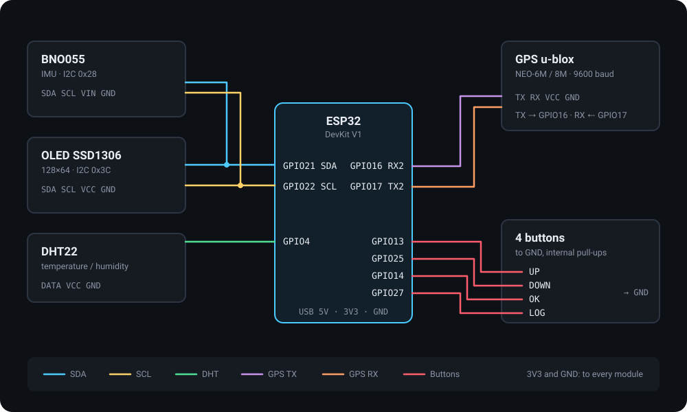

# Hardware compatibility

Which components work, how the firmware recognises them, and what to check on the first build. How the drivers are made is in [DRIVERS.md](DRIVERS.md).

*Italian version: [HARDWARE.md](../HARDWARE.md).*

> **State of the checks.** Only the fitted setup has been tried on real hardware. The other components are written from their datasheets, the arithmetic (conversions, checksums, attitude filter) is checked on a PC and everything is **checked by compiling**, but not in the field. Rows marked 🔧 have never been tried physically: on the first build follow [TESTING.md](TESTING.md).

---

## Fitted setup

| Category | Component | Bus | Address / Pin |
|---|---|---|---|
| MCU | ESP32 DevKit V1 | - | - |
| IMU | Bosch BNO055 | I2C | `0x28` |
| Display | SSD1306 128×64 OLED | I2C | `0x3C` |
| Weather | DHT22 / AM2302 | one-wire | GPIO 4 |
| GPS | u-blox NEO-6M / NEO-8M | UART2 | GPIO 16/17 |
| Buttons | 4× tactile | GPIO | 13 / 25 / 14 / 27 |



## Recognised by themselves

**Nothing is chosen in `Config.h`** for the weather sensor, the IMU, the GPS, the display address and the microSD: at power-up the firmware looks for them and uses what answers. The boot screen shows the name of what it found, the serial monitor a few more details (for the GPS, the serial speed and the reports per second obtained).

`Config.h` only keeps what cannot be asked of the component: the display controller, whether the display is on SPI, which IMUs with a library to include, and how the IMU sits in the box.

---

## Microcontroller: which ESP32

The firmware runs on the whole family. What changes is the **GPIO numbers**: on the S3 and the C3, pins 22, 25 and 27 of the DevKit V1 do not exist at all, and the C3 has two UARTs instead of three. So `Config.h` has four pinouts, picked by the preprocessor through the core's `CONFIG_IDF_TARGET_*` macros: selecting the board in the IDE is enough.

| Chip | State | UP/DOWN/OK/LOG | DHT | SDA/SCL | GPS RX/TX | SPI SCK/MISO/MOSI, microSD CS | Flash |
|---|---|---|---|---|---|---|---|
| **ESP32** (DevKit V1, WROOM, WROVER) | fitted | 13 / 25 / 14 / 27 | 4 | 21 / 22 | 16 / 17 | 18 / 19 / 23, 5 | 1224886 B (93 %) |
| **ESP32-S3** | 🔧 | 5 / 6 / 7 / 15 | 4 | 8 / 9 | 18 / 17 | 12 / 13 / 11, 10 | ~87 % (v11.1) |
| **ESP32-S2** | 🔧 | 5 / 6 / 7 / 15 | 4 | 8 / 9 | 18 / 17 | 12 / 13 / 11, 10 | ~84 % (v11.1) |
| **ESP32-C3** | 🔧 | 3 / 4 / 5 / 6 | 10 | 8 / 9 | 0 / 1 | - (no microSD) | 1267021 B (**96 %**) |

The 🔧 pinouts compile and respect the chip's constraints, but **none has ever been wired**: before soldering, compare them with your board's silkscreen.

**The C3 is at 96% of the flash**: it is the RISC-V core, ~80 KB more for the same source, and about 45 KB are left. On the other boards the microSD costs ~43 KB (on the classic ESP32: 90% without, 93% with). S3 and S2 are the v11.1 figures: this version adds a few points.

**Constraints if you change pins:**

- **strapping pins** decide the boot mode: a *button* held at power-up would prevent booting. They are `0, 2, 12, 15` (ESP32), `0, 3, 45, 46` (S3), `0, 45, 46` (S2), `2, 8, 9` (C3). **I2C is fine there**: the pull-ups keep the lines high at rest, which is the normal boot state, like SDA/SCL on the C3;
- **internal SPI flash**: `6-11` (ESP32), `26-32` (S2), `12-17` (many C3 modules);
- **native USB**: `19/20` (S2, S3), `18/19` (C3).

Two traps:

- **C3 and S2 have only two UARTs** and number 0 belongs to the serial monitor: the GPS gets number 1 (`GPS_UART_NUM`). Writing 2 there gives no compile error, it gives a silent serial port, meaning a GPS that shows as missing for no apparent reason.
- **On the classic ESP32, GPIO 34-39 are input only with no internal pull-up:** useless for the buttons as they are wired. It is the easy mistake when looking for free pins on a 38-pin board.

For a board not listed, copy the closest block in `Config.h`.

---

## I2C bus map: check before buying

Display, IMU and an I2C weather sensor share **the same bus** (SDA 21 / SCL 22 on the classic ESP32, 8 / 9 on the other variants). The firmware finds each one's address by itself, but **two parts on the same address do not work**: usually one of them disappears, seemingly at random.

| Address | Components |
|---|---|
| `0x28` / `0x29` | BNO055 |
| `0x38` | AHT10 / AHT20 / AHT21 / AHT25 |
| `0x3C` / `0x3D` | OLED display |
| `0x40` | HDC1080, Si7021, HTU21D, SHT21, HTU31D (one at a time) |
| `0x41` | HTU31D with ADDR high |
| `0x44` / `0x45` | SHT4x (`0x44` only), SHT3x |
| `0x4A` / `0x4B` | BNO085 / BNO086 |
| `0x5C` | AM2320 |
| `0x68` / `0x69` | MPU6050 family, ICM-20948 |
| `0x6A` / `0x6B` | LSM6DS3 / DSL / DSO / DSOX, ISM330DHCX |
| `0x70` | SHTC3 |
| `0x76` / `0x77` | BME280 |

Where two chips share an address (`0x40`, `0x44`, `0x68`) the firmware tells them apart by an identity register or by the CRC of their answer, trying them in a set order: [DRIVERS.md](DRIVERS.md#recognition). No combination of one display, one IMU and one weather sensor from this table clashes.

---

## Weather sensor

All read **without a library** except the DHT: the firmware talks to the chip directly, with the datasheet's conversion formulas (checked on a PC in `src/core/SensorMath`). Any of them will do: the first that answers is used.

| Component | State | Bus | Address | Notes |
|---|---|---|---|---|
| **DHT22 / AM2302** | fitted | one-wire | GPIO 4 | Read every 2 s: more often it repeats its last value |
| **DHT11** | 🔧 | one-wire | GPIO 4 | Recognised by the format of its answer. Poor accuracy (±2 °C, ±5 %), whole numbers |
| **Sensirion SHT4x** (SHT40/41/45) | 🔧 **recommended** | I2C | `0x44` | The current generation: ±1.8 %RH, ±0.2 °C. **If you buy today, buy this.** Heater kept off: it would warm the sensor and skew the temperature the grip risk depends on |
| **Sensirion SHT3x** (SHT30/31/35) | 🔧 | I2C | `0x44` / `0x45` | Previous generation: ±2 %RH, ±0.3 °C |
| **Sensirion SHTC3** | 🔧 | I2C | `0x70` | Small and cheap, ±2 %RH, ±0.2 °C |
| **TI HDC1080** | 🔧 | I2C | `0x40` | ±2 %RH, ±0.2 °C |
| **Si7021 / HTU21D / SHT21** | 🔧 | I2C | `0x40` | Classics, compatible with each other |
| **TE HTU31D** | 🔧 | I2C | `0x40` / `0x41` | Comparable to the SHT3x for less money |
| **AHT10 / AHT20 / AHT21 / AHT25** | 🔧 | I2C | `0x38` | The cheapest: the error against the reference **changes with temperature** and tends to read high. Fine for an indicative index like the grip risk |
| **Aosong AM2320** | 🔧 | I2C | `0x5C` | The I2C version of the DHT22 |
| **Bosch BME280** | 🔧 | I2C | `0x76` / `0x77` | Also measures pressure, which the firmware ignores |

> ⚠️ **BME280 / BMP280 trap.** They look identical and share **the same address**, but the BMP280 has no humidity sensor. It is one of the most common wrong substitutions among modules sold online. For this project it is not a detail: **humidity is half of the grip risk formula**. The firmware recognises the BMP280 by its chip ID and explains it on the serial monitor instead of silently ignoring it.

**Category requirement:** temperature *and* humidity. A temperature-only sensor is not a partial alternative: without humidity the grip risk cannot be computed.

---

## IMU

| Component | State | Address | Library | Notes |
|---|---|---|---|---|
| **Bosch BNO055** | fitted | `0x28` / `0x29` | Adafruit BNO055 | Fusion in the chip. End of life: see below |
| **BNO085 / BNO086** | 🔧 **recommended** | `0x4A` / `0x4B` | Adafruit BNO08x | The BNO055's successor. Turn on in `Config.h` (`IMU_WITH_BNO08X`): its library takes ~10 KB of flash |
| **ISM330DHCX** | 🔧 | `0x6A` / `0x6B` | none | Industrial version of the LSM6DSO: the most robust to vibration |
| **LSM6DS3 / DSL / DSO / DSOX** | 🔧 | `0x6A` / `0x6B` | none | Common on Adafruit and SparkFun boards |
| **ICM-20948** | 🔧 | `0x68` / `0x69` | none | The MPU9250's successor; the magnetometer is not used |
| **MPU6050 / MPU6500 / MPU9250** | 🔧 | `0x68` / `0x69` | none | The most widespread (GY-521). Cheap but noisy: mount it rigidly |
| **ICM-20602 / ICM-20689** | 🔧 | `0x68` / `0x69` | none | Same registers as the MPU6500 |

### Two ways to get the attitude

- **The BNO055** does everything in the chip and hands over ready-made angles: it is the path the firmware was born and tested with, and it stays that way.
- **All the others** hand over raw accelerometer and gyroscope, and the firmware works out the attitude with a Madgwick filter (`src/core/Ahrs`). **The BNO085 too**, even though it could do it itself: its fusion does not know the bike's speed, and without speed the lean in a corner cannot be seen (below).

**Why the speed is needed.** In a steady corner the bike leans so that gravity and centrifugal force, added up, lie in its own plane: the accelerometer "sees" gravity straight down the bike, and a filter trusting it reads a lean close to zero. The same happens to pitch under braking. The firmware's filter takes out of the accelerometer what the motion puts in, worked out from the GPS speed and the gyroscope (forward: the change of speed; sideways: speed times yaw rate), and what is left is gravity. The PC tests simulate a corner at 20° and at 40° and a braking: with the correction the lean comes back within a degree, without it the 20° is lost. Without a GPS fix the correction simply is not there.

At boot the IMUs without fusion measure the **gyroscope's zero** for a second (the offset it has even when still): the box must stay still during the boot screen.

### How it sits in the box

For the BNO055 it is set by `IMU_BNO055_REMAP`, for all the others by `IMU_AXES` in `Config.h`: which chip axis points forward, left and up. The `IMU_MOUNT_UPRIGHT` and `IMU_MOUNT_UPSIDE_DOWN` positions set both, assuming the chip's X axis (printed on nearly every breakout) points to the front. The README's four checks tell whether it is right.

---

## OLED display

The firmware finds the **address** (`0x3C` or `0x3D`). Not the **controller**: different panels answer on the same address, so it is chosen in `Config.h`.

| Component | State | Macro | Notes |
|---|---|---|---|
| **SSD1306 128×64** | fitted | `DISPLAY_SSD1306` | The classic 0.96" ones |
| **SH1106 128×64** | 🔧 | `DISPLAY_SH1106` | Usually the 1.3" modules. Pixel-identical layout |
| **SSD1309 128×64** | 🔧 | `DISPLAY_SSD1309` | Larger panels (2.42"); same driver as the SSD1306 |
| **SH1107 128×64** | 🔧 | `DISPLAY_SH1107` | ⚠️ Most SH1107 modules are 128×128: not supported |
| **SSD1306 128×32**, **128×128** | ❌ | - | The layout is hand-drawn for 128×64: three data rows do not fit on 32 |

**On SPI** (`DISPLAY_SPI` in `Config.h`): the SSD1306 and SH1106 also come in a seven-pin SPI version. It is faster, but on SPI there is no way to ask whether the panel is there, so it is taken as present. The CS, DC and RST pins are in `Config.h`; the bus is the microSD's. Not on the C3, which has no pins left.

> **If you buy an "SSD1306" OLED and the image appears shifted two pixels, or with a column of noise on the edge, it is not broken: it is an SH1106.** It is very common: that controller gets resold under the better-known name. `DISPLAY_SH1106` fixes it.

---

## GPS

The firmware finds the serial speed by itself (9600, 38400, 115200, 57600), the module's family, and configures it for the highest rate it can take. Then it **measures** how many reports per second really arrive and sets from that how long before the fix counts as lost.

| Component | State | Family | Rate |
|---|---|---|---|
| **u-blox NEO-6M** | fitted | u-blox, old commands | 5 Hz (the chip goes no higher) |
| **u-blox NEO-M8N, Beitian BN-220 / BN-880** | 🔧 **recommended** | u-blox, old commands | 10 Hz |
| **u-blox NEO-M9N** | 🔧 | u-blox, old commands | 10 Hz |
| **u-blox MAX-M10S, Beitian M10 series** | 🔧 | u-blox, CFG-VALSET keys | 10 Hz |
| **ATGM336H, Quectel L76K** | 🔧 | CASIC (`$PCAS`) | 10 Hz |
| **Quectel LC76G / LC86G / LC29H** | 🔧 | Airoha (`$PAIR`) | 10 Hz |
| **Any other NMEA module** | 🔧 | - | Its factory rate, usually 1 Hz |

**How the family is recognised.** It asks the module for its version over the UBX protocol: if it answers it is a u-blox, and the hardware version says whether it wants the old configuration messages (up to the M9) or the new keys (M10: the old ones were removed). If it does not answer, the commands of the two families CASIC and Airoha are sent: each ignores the other's. In every case it turns off the unused NMEA sentences, takes the serial line to 115200 (at 9600 10 Hz do not fit) and asks for 10 Hz, or 5 if the module refuses.

**What the rate changes.** At 100 km/h there are 2.8 m between two positions at 10 Hz, 5.6 m at 5 Hz, 28 m at 1 Hz. The pass over the line is interpolated between the two positions, but the closer they are the better the constant-speed assumption holds: lap times are more precise and the delta updates more often.

The settings go to the module's RAM: switched off, it returns to factory settings, and at the next power-up the firmware configures it again. If the ESP32 restarts with the GPS still powered (after an update over WiFi), the module is still at 115200: that is why the speed is searched for and not taken for granted.

---

## MicroSD

With a microSD card (FAT32) the sessions go there instead of the internal flash: hundreds of hours instead of about five. Tracks, records and settings stay on the internal flash. The card is looked for **at power-up**: put in later, it is seen at the next restart.

- **Module**: a 3.3 V one, or a module with regulator and level shifter (the six-pin ones marked "VCC 5V" must be powered at 5 V). SPI pins and CS are in the microcontroller table above.
- **Storage page and website**: they show the card's space (in GB) and, on the website, "microSD" next to Storage.
- **Not on the C3**: it has no free pins for SPI.
- **Cost**: FAT support takes about 50 KB of flash. On a board without a reader, remove it with `-DNO_SD_CARD` (or by commenting out `SD_CARD` in `Config.h`).

---

## Buttons

Four GPIOs with internal pull-up, one side to the pin and the other to GND: no external resistors. They move to any free pin by changing `PIN_BTN_*` in `Config.h`.

Changing their **number** is another matter: it is not a hardware problem but an interface one (with three keys you would need to rethink how to move through the pages and reach the actions of `handleButtons()` in `src/App.cpp`).

---

## Power from the bike 🔧

On the bench USB is enough. On the bike it is better to take power from the electrical system: no battery to recharge, and the box turns on and off with the key. **Nothing in this section has been built and tried yet**: these are the standard choices for 12 V vehicle electronics, to be checked on the first build.

### The basic wiring

```
switched +12 V ── 1 A fuse ──┬── Schottky ──── converter ──── 5 V ──→ ESP32 VIN
                             │   diode         12 V → 5 V
                             └── TVS ── GND                   GND ──→ ESP32 GND
```

- **Take the +12 V from a switched line**, for example the accessory socket or a parking-light wire, not straight from the battery: that way it turns off with the bike and does not drain it when parked.
- **A 1 A blade fuse**, as close as possible to where you tap the power. It protects the bike's wiring, not the electronics.
- **A Schottky diode in series** (for example SS34 or 1N5819): swap the wires and nothing burns.
- **A TVS diode** between +12 V and ground (for example SMBJ24A): it clips the spikes a bike's electrical system produces, above all if the battery comes loose with the engine running. Many cheap converters do not have one.
- **A switching converter from 12 V to 5 V**, at least 1 A, with an input rated to 30 V or more. A good USB car charger also works. Not a linear regulator such as a 7805: dropping from 14 V to 5 V it would run hot.
- **The 5 V goes to the VIN** (or 5V) pin of the DevKit, never to 3V3. If you also plug USB into a computer with the bike on, check your board has the diode on the USB supply (the DevKit V1 usually does).

### Turning off without losing the session (optional)

With the basic wiring, turning the key while recording loses the last seconds and the session summary, lap times included: the website shows it as "cut short with no summary". With two additions the firmware notices the key and closes the session before the power is gone.

**1. A capacitor that keeps the ESP32 running for a moment.** A 0.47-1 F, 5.5 V supercapacitor between 5 V and ground, *after* a Schottky diode (the diode stops it discharging backwards into the converter). The ESP32 with WiFi on draws up to ~250 mA and its regulator stops working below ~4.3 V: from 4.7 V (5 V minus the diode) a 0.47 F capacitor lasts about 0.47 × 0.4 / 0.25 ≈ **0.75 s**. Closing the session takes under a tenth of a second. At power-up the empty capacitor draws a lot of current for a few seconds: a converter with current limiting copes, one without may fail to start at the first try.

**2. A divider reading the 12 V.** Taken *before* the diode and the capacitor, or it would see the voltage the capacitor holds up:

```
switched +12 V (after the fuse) ── 100 kΩ ──┬── ESP32 ADC pin
                                            ├── 22 kΩ ── GND
                                            └── 100 nF ── GND
```

With these values 14.4 V (engine running) becomes 2.6 V on the pin; the 100 nF capacitor filters ignition noise. The pin must be on **ADC1**, because ADC2 stops working while the WiFi is on: on the classic ESP32, GPIO 32-39 (34 is handy, it is input only).

**3. In `Config.h`** uncomment `#define POWER_SENSE_PIN 34` (or the pin you used). Change `POWER_SENSE_DIVIDER` only if you use different resistors; `POWER_OFF_VOLTS` (6 V) is the threshold below which the key counts as off: cranking pulls the voltage down to around 9-10 V, so it stays above.

When the voltage stays below the threshold for 60 ms, the firmware closes the recording with its summary and the display shows `SESSION SAVED`. The serial monitor prints the voltage read every five seconds (`Power : 13.8 V`): that is how to check the divider before riding. The full test is in [TESTING.md](TESTING.md).


---

## ⚠️ The BNO055 is end of life

Bosch lists it as **"not recommended for new designs"**. It will stay available for a long time on breakouts already made, but for a new box a **BNO085/BNO086** (same footprint, fusion in the chip, calibration saved by itself) or an **ISM330DHCX / LSM6DSO** is better, read through the firmware's filter that accounts for speed.

Changing IMU in the same box means redoing the four orientation checks: the BNO055 uses `IMU_BNO055_REMAP` and the `SIGN_*`, the others `IMU_AXES`. The calibration screen at boot exists only for the BNO055 (its magnetometer starts uncalibrated at every power-up): with the others it closes by itself.

---

## Excluded components

| Component | Why |
|---|---|
| **Flash under 4 MB** | The WiFi update uses the two application slots of the default partition scheme. |
| **Displays other than monochrome 128×64** | The page layout is hand-drawn for 128×64. |
| **Microcontrollers outside the Espressif family** | The constraint is the **WiFi**: native `WiFi.h` + `WebServer.h` + LittleFS exist only there. STM32 needs external WiFi hardware, classic Arduino lacks the RAM for the web server. |
| **ESP8266** | It has WiFi, but different APIs and only one full UART, already taken by the serial monitor: a port, not a configuration change. |

---

## Fitting a different component

1. **Wire it** on the same bus (I2C: SDA/SCL, 3.3 V, GND) and check its address is not taken already (map above).
2. **Power up** and look at the boot screen: the name of the component found appears in its row. A cross means it does not answer: wiring or power.
3. **Only when needed**: an SPI display or a controller other than the SSD1306, and a BNO085 (`IMU_WITH_BNO08X`), are set in `Config.h`.
4. **For an IMU**, redo the four orientation checks.
5. **Try it on the hardware**: [TESTING.md](TESTING.md).

To add a component not in this list: [DRIVERS.md](DRIVERS.md).
